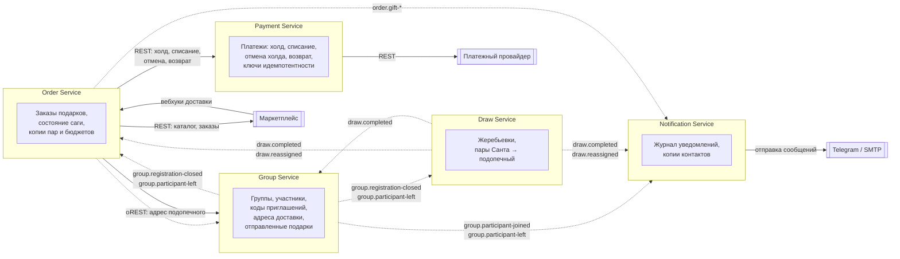

# 1. Карта контекстов

Ответственный: Анзор (абзацы про Draw, Payment и Order пишут их владельцы).

## Диаграмма

Сплошные стрелки — синхронные вызовы (REST), пунктирные — события через RabbitMQ. Стрелка идет от того, кто инициирует взаимодействие.

## Отношения между контекстами

| Связь | Тип отношения | Комментарий |
|---|---|---|
| Group → Draw, Order, Notification | Публикатор событий (Published Language) | Group публикует события в общем формате, потребители сами решают, что с ними делать |
| Draw → Order, Notification, Group | Публикатор событий (Published Language) | Пары передаются событиями, Order и Notification хранят копии; Group по `draw.completed` только переводит группу в `DRAWN` |
| Order → Group, Notification | Публикатор событий (Published Language) | Group узнает об отправке подарков, Notification — обо всех статусах заказа |
| Order → Payment | Заказчик и поставщик (Customer/Supplier) | Order — заказчик: Payment предоставляет API под нужды саги |
| Order → Group | Заказчик и поставщик (Customer/Supplier) | Отдельный внутренний метод выдачи адреса только для Order |
| Payment → Платежный провайдер | Предохранительный слой (Anticorruption Layer) | Модель провайдера не проникает в нашу систему, Payment переводит ее в свои статусы |
| Order → Маркетплейс | Предохранительный слой (Anticorruption Layer) | Статусы и форматы маркетплейса переводятся в наши `GiftOrderStatus` |
| Notification → Telegram / SMTP | Конформист (Conformist) | Используем API как есть |

## Сервисы

### Group Service

Отвечает за группы и участников: создание группы, вступление по коду приглашения, адреса доставки, выход из группы, закрытие регистрации. Это единственное место, где хранятся адреса и контакты участников, то есть персональные данные. Выделен отдельно, потому что жизненный цикл группы (регистрация длится неделями) не связан с жизненным циклом заказов и платежей, а доступ к адресам нужно жестко ограничить: их получает только Order Service через внутренний метод. Если Group Service упадет, уже начатые заказы и уведомления продолжат работать на копиях данных. Из событий Order Service он узнает, чьи подарки уже в доставке, и не дает таким участникам выйти из группы: отправленный подарок уже нельзя отменить.

### Draw Service

Отвечает за жеребьевку и перестройку пар при выходе участника. Пары — это данные, которые нельзя задвоить: у каждого участника ровно один Санта и ровно один подопечный. Выделен отдельно, потому что у жеребьевки своя логика (алгоритм кольца, перестройка) и свой режим секретности: никто, кроме самого Санты, не должен видеть пару. Жеребьевка запускается событием и выполняется асинхронно, поэтому временная недоступность Draw Service не мешает закрыть регистрацию: событие подождет в очереди.

### Payment Service

Отвечает за деньги: холд, списание, отмену холда и возврат через платежного провайдера. Выделен отдельно, потому что к нему самые строгие требования по надежности: ни одна операция не должна выполниться дважды или потеряться, каждый запрос идемпотентен, все изменения статусов хранятся. Кроме того, он изолирует нашу систему от конкретного платежного провайдера: при смене провайдера меняется только этот сервис.

### Order Service

Отвечает за выбор подарка и главный процесс системы — сагу заказа подарка: холд денег → получение адреса → заказ на маркетплейсе → списание денег, с компенсациями при сбое на любом шаге. Выделен отдельно, потому что координирует несколько сервисов и внешнюю систему, хранит состояние саги и должен уметь продолжить ее после падения. Также принимает вебхуки маркетплейса о доставке.

### Notification Service

Отвечает за отправку сообщений участникам в Telegram и на почту: результат жеребьевки, смена подопечного, статусы заказа. Выделен отдельно, потому что уведомления не должны влиять на главный процесс: если Telegram или почта недоступны, заказ все равно оформляется, а сообщения отправятся позже. Работает только на событиях и хранит копию контактов, поэтому не зависит от доступности Group Service.

### API Gateway

Не является отдельным контекстом предметной области. Единая точка входа для клиента: проверяет токен, передает сервисам `X-User-Id` и `X-Request-Id`, закрывает внешний доступ к путям `/internal`.
