# 2. C4: уровень Container

Ответственный: Маша.

```mermaid
C4Container
    title Тайный Санта: контейнеры

    Person(user, "Участник", "Организатор, Санта или подопечный")

    System_Boundary(santa, "Тайный Санта") {
        Container(web, "Веб-клиент", "SPA", "Интерфейс участника")
        Container(gw, "API Gateway", "HTTP-шлюз", "Аутентификация, маршрутизация, закрывает /internal")

        Container(group, "Group Service", "REST-сервис", "Группы, участники, адреса")
        ContainerDb(groupDb, "group_db", "PostgreSQL", "groups, participants, shipped_gifts, outbox, processed_events")

        Container(draw, "Draw Service", "REST-сервис", "Жеребьевка и перестройка пар")
        ContainerDb(drawDb, "draw_db", "PostgreSQL", "draws, pairs, outbox, processed_events")

        Container(order, "Order Service", "REST-сервис", "Заказ подарка, оркестратор саги")
        ContainerDb(orderDb, "order_db", "PostgreSQL", "gift_orders, saga_state, копии пар, outbox, processed_events")

        Container(payment, "Payment Service", "REST-сервис", "Холд, списание, возврат")
        ContainerDb(paymentDb, "payment_db", "PostgreSQL", "payments, idempotency_keys")

        Container(notify, "Notification Service", "Обработчик событий", "Уведомления участникам")
        ContainerDb(notifyDb, "notification_db", "PostgreSQL", "notifications, contacts, processed_events")

        ContainerQueue(mq, "RabbitMQ", "AMQP", "Exchange: group.events, draw.events, order.events")
    }

    System_Ext(pp, "Платежный провайдер", "Холд и списание с карты")
    System_Ext(mp, "Маркетплейс", "Каталог, заказы, доставка")
    System_Ext(tg, "Telegram Bot API", "Сообщения в Telegram")
    System_Ext(smtp, "SMTP-сервер", "Письма")

    Rel(user, web, "Использует", "HTTPS")
    Rel(web, gw, "Вызывает API", "HTTPS/JSON")
    Rel(gw, group, "Маршрутизирует", "HTTP/JSON")
    Rel(gw, draw, "Маршрутизирует", "HTTP/JSON")
    Rel(gw, order, "Маршрутизирует", "HTTP/JSON")

    Rel(group, groupDb, "Читает и пишет", "SQL")
    Rel(draw, drawDb, "Читает и пишет", "SQL")
    Rel(order, orderDb, "Читает и пишет", "SQL")
    Rel(payment, paymentDb, "Читает и пишет", "SQL")
    Rel(notify, notifyDb, "Читает и пишет", "SQL")

    Rel(order, group, "Получает адрес подопечного", "HTTP/JSON")
    Rel(order, payment, "Холд, списание, отмена, возврат", "HTTP/JSON")
    Rel(payment, pp, "Операции с картой", "HTTPS/JSON")
    Rel(order, mp, "Каталог и заказы", "HTTPS/JSON")
    Rel(mp, order, "Вебхуки доставки", "HTTPS/JSON")

    Rel(group, mq, "Публикует и получает события", "AMQP")
    Rel(draw, mq, "Публикует и получает события", "AMQP")
    Rel(order, mq, "Публикует и получает события", "AMQP")
    Rel(notify, mq, "Получает события", "AMQP")

    Rel(notify, tg, "Отправляет сообщения", "HTTPS")
    Rel(notify, smtp, "Отправляет письма", "SMTP")
```

## Пояснения

- **Технологии сервисов** указаны обобщенно («REST-сервис»): язык и фреймворк выберем перед второй частью. Это не влияет на архитектуру.
- **База на сервис.** У каждого сервиса своя база PostgreSQL, другие сервисы к ней не обращаются. Данные чужих сервисов попадают к нам только через API или события.
- **Payment Service не подключен к RabbitMQ**: его вызывает только Order Service синхронно, событий он не публикует.
- **Таблица `outbox`** есть у всех, кто публикует события (Group, Draw, Order): событие записывается в той же транзакции, что и изменение данных, а затем отправляется в брокер (см. [ADR-003](05-adr/ADR-003-outbox.md)).
- **Таблица `processed_events`** есть у всех потребителей событий: по `eventId` они отбрасывают повторно доставленные сообщения (см. [ADR-004](05-adr/ADR-004-idempotency.md)).
- **Внешние системы** во второй части будут эмуляторами, которые можно заставить отвечать ошибкой или не отвечать, чтобы показать сценарии сбоя.
