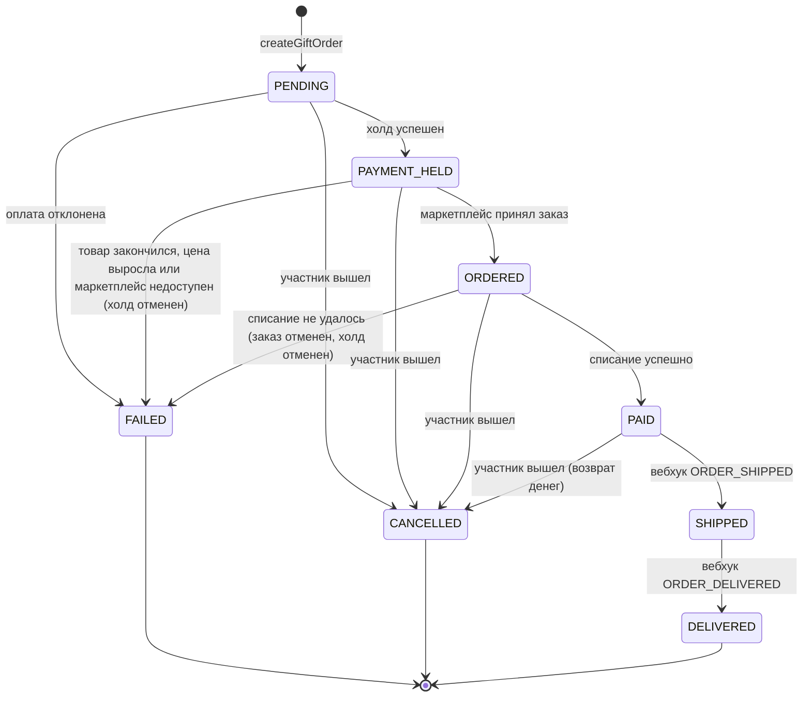
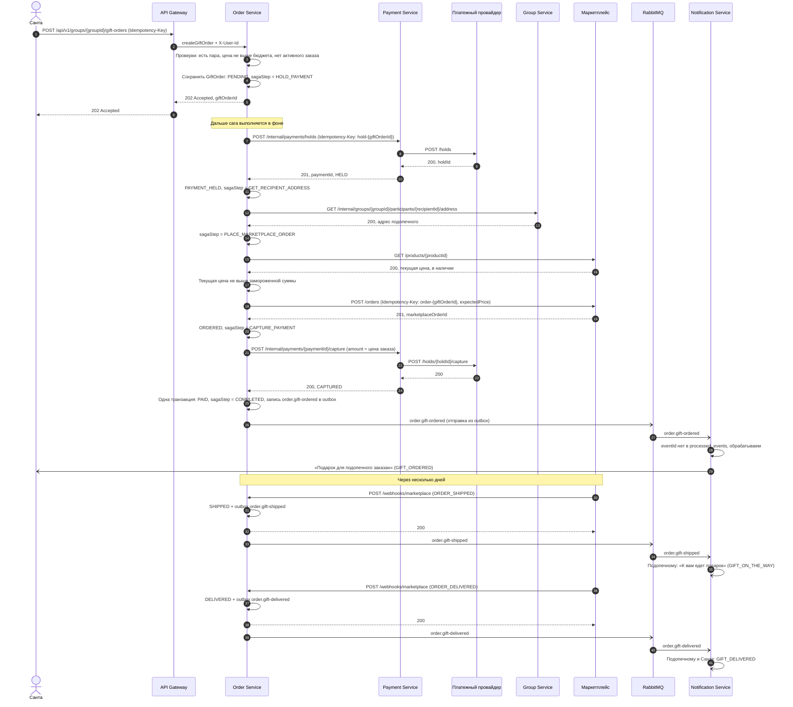
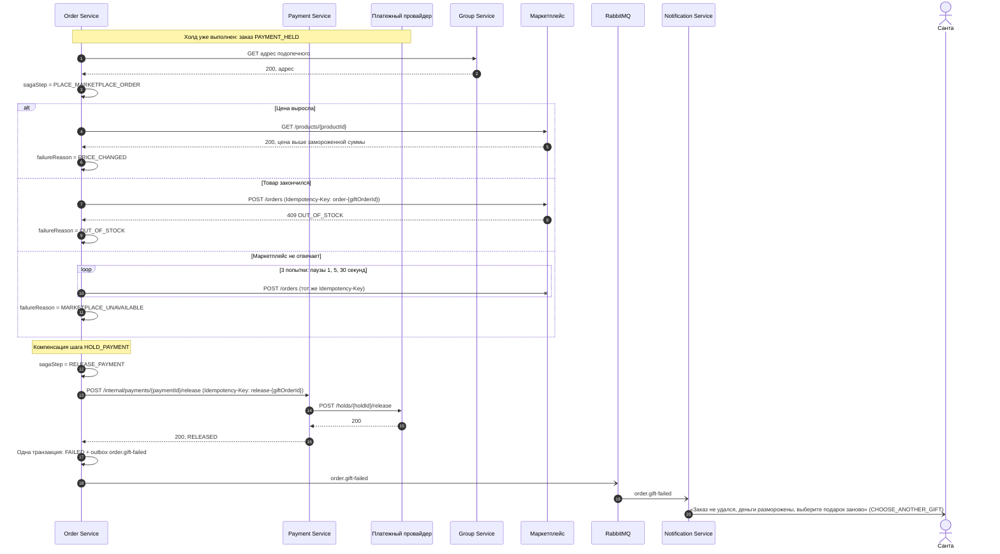
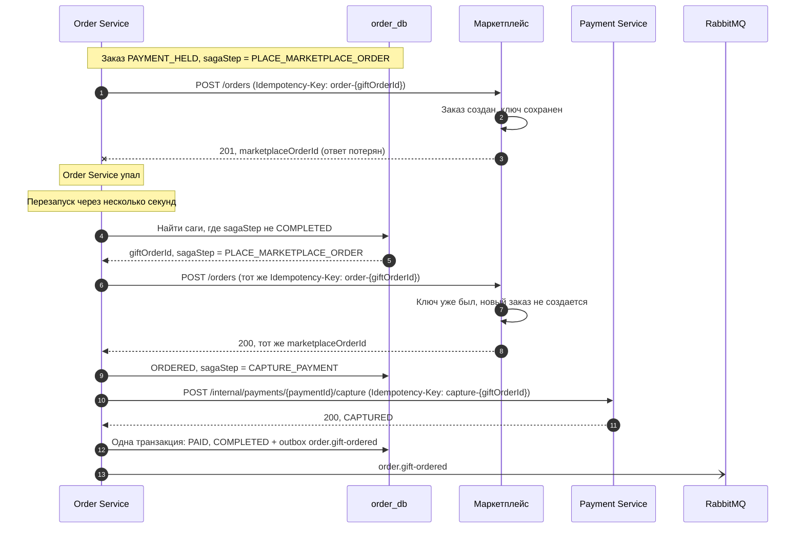
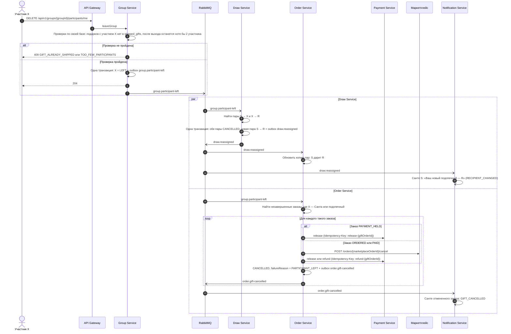

# 4. Главный процесс: заказ подарка

Ответственные: Алиса (успешный сценарий, сбои 1 и 2, диаграмма состояний), Маша (сбой 3).

Главный процесс системы — сага заказа подарка. Ее координирует Order Service (оркестрация, см. [ADR-001](05-adr/ADR-001-saga-orchestration.md)). Шаги саги:

| Шаг (`sagaStep`) | Что делает | Компенсация при сбое следующих шагов |
|---|---|---|
| `HOLD_PAYMENT` | Payment Service замораживает цену подарка на карте Санты | `RELEASE_PAYMENT` — отменить холд |
| `GET_RECIPIENT_ADDRESS` | Group Service отдает адрес подопечного | не нужна (только чтение) |
| `PLACE_MARKETPLACE_ORDER` | Order Service проверяет текущую цену товара, затем маркетплейс принимает заказ с адресом подопечного | `CANCEL_MARKETPLACE_ORDER` — отменить заказ |
| `CAPTURE_PAYMENT` | Payment Service списывает замороженную сумму | `REFUND_PAYMENT` — вернуть деньги |

Перед каждым вызовом Order Service сохраняет текущий шаг в `saga_state`, а каждый вызов идет с ключом идемпотентности (`hold-{giftOrderId}`, `order-{giftOrderId}` и т. д.). Благодаря этому после падения сага продолжается с того же шага без задвоений.

## Состояния заказа подарка

После `FAILED` Санта может создать новый заказ: правило «один активный заказ» не считает `FAILED` и `CANCELLED` активными.

## Сценарий 0. Успешный заказ подарка

## Сценарий сбоя 1. Товар закончился после холда

**Что ломается.** Пока Санта выбирал подарок и проходил холд, последний экземпляр товара купили. Маркетплейс отказывает в заказе, а деньги Санты уже заморожены.

**Как система компенсирует.** Order Service выполняет компенсацию шага `HOLD_PAYMENT`: отменяет холд, переводит заказ в `FAILED` с причиной `OUT_OF_STOCK` и просит Санту выбрать другой подарок. Если маркетплейс не ответил вообще, сначала идут повторы, а потом та же компенсация с причиной `MARKETPLACE_UNAVAILABLE`.

Та же компенсация срабатывает, если товар за это время подорожал и стал дороже замороженной суммы (`PRICE_CHANGED`, бизнес-правило 10): доплату без согласия Санты мы не делаем. Если товар подешевел, сбоя нет: заказ оформляется по новой цене, списывается меньше, чем заморожено, а остаток холда размораживается.

**Что если не удалась и сама компенсация** (Payment Service или провайдер недоступны при отмене холда)? Шаг `RELEASE_PAYMENT` сохранен в `saga_state`, фоновый обработчик повторяет его, пока не получится. Отмена холда идемпотентна, поэтому повтор безопасен. В худшем случае холд снимет сам банк по истечении срока, но деньги в любом случае не списываются.

## Сценарий сбоя 2. Order Service упал посреди саги

**Что ломается.** Order Service отправил заказ на маркетплейс, маркетплейс заказ принял, но Order Service упал до того, как сохранил ответ. После перезапуска он не знает, создан ли заказ. Если просто отправить заказ еще раз, подопечный получит два подарка, а Санта заплатит за один.

**Как система компенсирует.** Состояние саги хранится в базе, а не в памяти. После перезапуска фоновый обработчик находит незавершенные саги и повторяет текущий шаг с тем же ключом идемпотентности. Маркетплейс по ключу узнает повтор и возвращает уже созданный заказ, а не создает новый. Сага продолжается со списания денег.

Что еще важно в этом сценарии:

- **Повтор запроса от клиента.** Если Санта, не дождавшись ответа, нажал «Заказать» второй раз, запрос придет с тем же `Idempotency-Key`, и Order Service вернет уже созданный заказ.
- **Вебхуки, пришедшие во время падения**, не теряются: маркетплейс повторяет их, пока не получит `200`.
- **Событие не потеряется**, даже если сервис упал сразу после записи `PAID`: событие лежит в `outbox` и будет отправлено после перезапуска. Если оно уйдет дважды, Notification Service отбросит повтор по `eventId`.
- **Холд не зависнет навсегда**: если сага стоит дольше 30 минут, она завершается компенсацией с причиной `TIMEOUT`.

## Сценарий сбоя 3. Участник вышел после жеребьевки

**Что ломается.** Жеребьевка проведена, кольцо пар замкнуто: … → Санта S → X → R → … Участник X выходит из игры. Теперь у S нет подопечного, а у R нет Санты. Кроме того, у X и S уже могут быть оформленные заказы: X мог заказать подарок для R, а S — для X.

**Как система компенсирует.**

1. Draw Service вырезает X из кольца: пары S → X и X → R отменяются, создается пара S → R. Кольцо снова замкнуто, и задвоений нет.
2. Order Service отменяет незавершенные заказы, связанные с X: заказ S для X (подарок больше некому дарить) и заказ X для R (X ушел). Деньги возвращаются: холд отменяется или списанные деньги возвращаются.
3. S получает уведомление о новом подопечном и выбирает подарок для R.

**Пояснения к сценарию.**

- События `draw.reassigned` и `group.participant-left` могут прийти в Order Service в любом порядке. Это не страшно: одно из них меняет копию пар, другое отменяет заказы, и они не мешают друг другу.
- **Подарок уже в доставке.** Отменить его нельзя, поэтому выйти из группы в этом случае тоже нельзя (бизнес-правило 8). Group Service проверяет это по своей копии `shipped_gifts`, которую заполняет из события `order.gift-shipped`, без синхронного вызова Order Service. Значит, выход работает, даже если Order Service недоступен.
- **Редкая гонка.** Если X вышел в те несколько секунд, когда подарок уже отправлен, а событие `order.gift-shipped` еще не дошло до Group Service, Order Service увидит заказ в статусе `SHIPPED` и не станет его отменять. Деньги при этом не теряются и не задваиваются: каждый Санта платит только за свой подарок. В худшем случае кто-то получит лишний подарок. Мы сознательно принимаем этот риск, чтобы не делать выход из группы зависимым от Order Service.
- **Двое оставшихся.** Если в группе осталось 2 участника, выйти нельзя (бизнес-правило 9): иначе последнему некому дарить. Перестройка кольца из трех участников дает пару «дарим друг другу», и это нормально.
- Если X выходит до жеребьевки, Draw Service и Order Service ничего не делают: пар еще нет. X просто не попадет в список участников события `group.registration-closed`.
